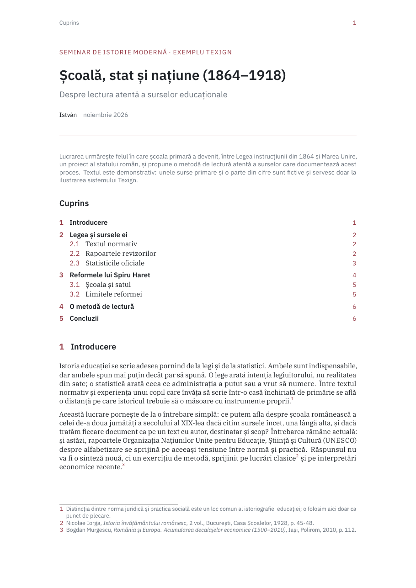
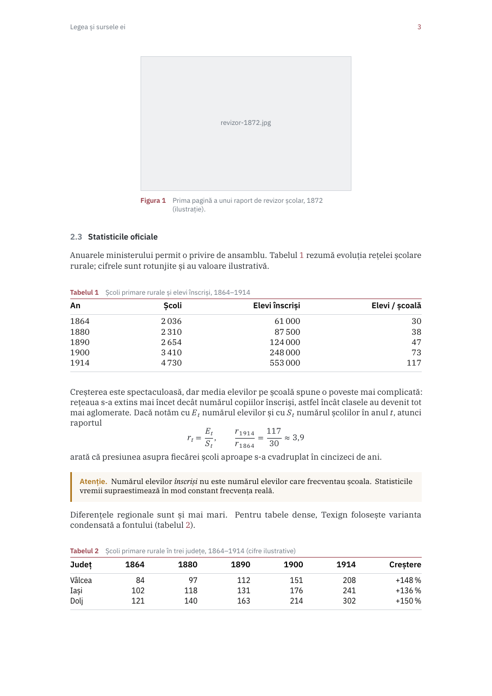
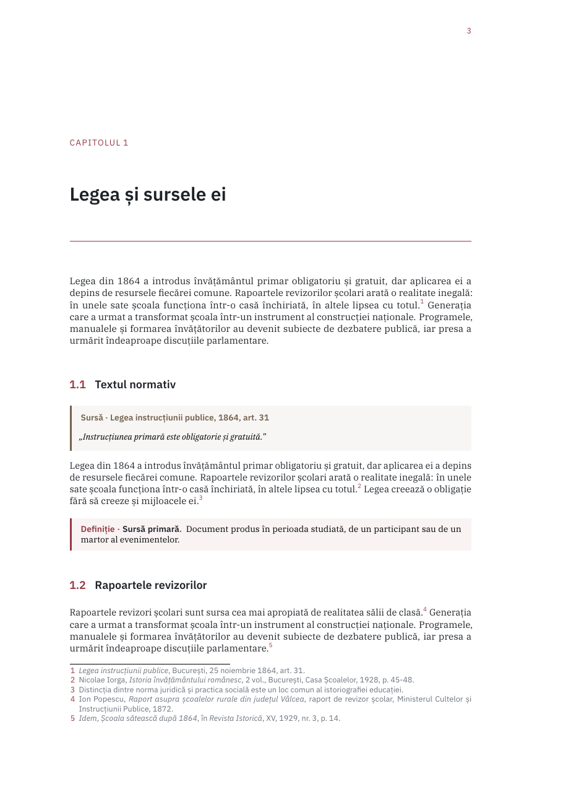
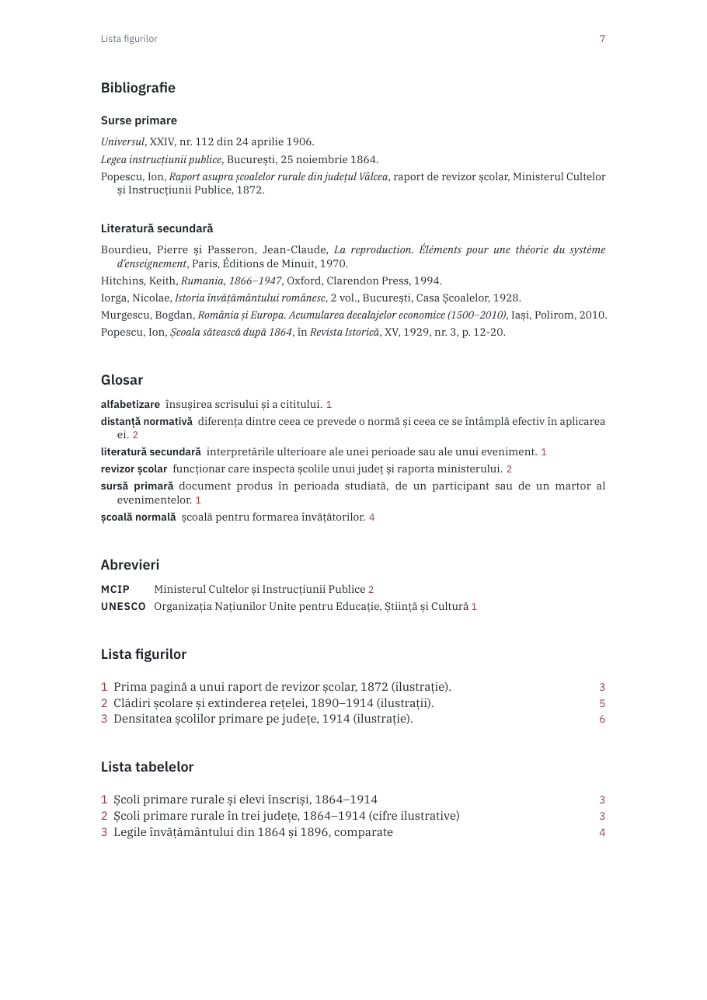

# Texign

A personal **LaTeX ecosystem** for academic writing in Romanian and English:
document classes for articles and books that share one quiet, modern
visual identity, with the apparatus humanities work needs (notes in three
modes, citations after the Romanian Academy norms or Chicago, primary and
secondary sources, glossary, index, timelines) and one command that builds
everything in the right order.

You write plain LaTeX with a handful of short commands; Texign takes care of
the typography, the notes and the build.

|                                                              |                                                              |
| ------------------------------------------------------------ | ------------------------------------------------------------ |
|  |    |
|        |     |

**Contents:** [Is this for you?](#is-this-for-you) ·
[What's inside](#whats-inside) ·
[Try it in 2 minutes](#try-it-in-2-minutes) ·
[Install it](#install-it) ·
[Everyday commands](#everyday-commands) ·
[Writing a document](#writing-a-document) ·
[Documentation](#documentation)

## Is this for you?

A good fit if:

- You write essays, papers, theses or books in **Romanian or English**,
  mostly in the humanities, and want them to look consistent without
  styling each one by hand.
- You cite a lot, and want notes that follow the **Romanian Academy** norms
  (with *Ibidem* and *op. cit.* handled for you) or **Chicago**, from one
  `.bib` file.
- You're comfortable editing a `.tex` file and running a command in a
  terminal on Linux or macOS.

Probably not a fit if:

- You need a journal's own class or a publisher's template. Texign is one
  identity, not a style toolkit.
- You want to use pdfLaTeX or XeLaTeX. Texign is LuaLaTeX only.
- You work on Windows without WSL. The classes work anywhere TeX Live does,
  but the `texign` command and the installer are Bash scripts.

## What's inside

- **Two classes**, `texign-article` and `texign-book` (KOMA-Script), with
  IBM Plex type, a Bordo accent and numbered headings in a wide margin.
- **Notes** with one command, `\note{}`, set as footnotes, margin notes or
  endnotes by one class option.
- **Citations** in five conventions, the Romanian Academy norms by default,
  and a bibliography split into primary sources and secondary literature.
- **Components**: information boxes, source extracts, quotations, two table
  styles, image grids, timelines and comparison tables.
- **Apparatus**: glossary and abbreviations, contents and lists of figures
  and tables, an index, all sorted in Romanian alphabetical order.
- **One command**, `texign build`, runs LuaLaTeX, Biber, bib2gls and
  upmendex as often as needed and shows each step.

## Try it in 2 minutes

This builds an example from the clone, without installing anything. You need
a recent **TeX Live** (2024 or newer) with LuaLaTeX, Biber, the IBM Plex
fonts and a Java runtime for bib2gls; most full TeX Live installations have
all of them.

```bash
git clone https://github.com/istorie-petru/texign.git
cd texign
tools/texign build examples/showcase/showcase.tex
```

Open `examples/showcase/showcase.pdf`. If something is missing,
`scripts/texign-ctl status` says what, with the package names for Arch,
Debian/Ubuntu and `tlmgr`. To remove it completely, delete the `texign`
folder.

## Install it

Texign installs **for your user only**: no `sudo`, nothing outside your home
folder.

```bash
git clone https://github.com/istorie-petru/texign.git /tmp/texign
/tmp/texign/scripts/texign-ctl install
rm -rf /tmp/texign
```

The installer takes the latest release, checks that it builds a test
document on your machine, and then:

- keeps it under `~/.local/share/texign/` (one folder per release, so an
  update can be undone);
- links the classes into your personal TeX tree (`~/texmf`), so every
  LaTeX editor finds `texign-article` and `texign-book`;
- puts the `texign`, `texign-ctl` and `texign-update` commands in
  `~/.local/bin`, and tells you if that folder is not on your `PATH`.

Add `--main` to follow the development branch instead of releases.

**Working on Texign itself?** Run `scripts/texign-ctl install --dev` from your
clone: TeX and the `texign` command then use that clone directly, and
`git pull` updates it.

## Everyday commands

| I want to… | Run |
|---|---|
| Update to the latest release | `texign-update` (or `texign-ctl update`) |
| Undo the last update | `texign-update --revert` (or `texign-ctl revert`) |
| See the version and check fonts and tools | `texign-ctl status` |
| Remove Texign | `texign-ctl remove` |
| Start a new document | `texign new article eseu` |
| Build a document | `texign build eseu.tex` |
| Rebuild on every save | `texign watch eseu.tex` |
| Remove the build files | `texign clean eseu.tex` |

An update never replaces a working version with a broken one: the new
release must build the test document first, and if it fails, the version you
had stays in place.

## Writing a document

```latex
\documentclass[notes=foot, citations=academia]{texign-article}
\addbibresource{surse.bib}
\title{Școala românească în secolul al XIX-lea}
\author{Numele Autorului}

\begin{document}
\maketitle
\section{Introducere}
Legea din 1864 face învățământul primar obligatoriu\cite[12]{lege1864}.
\note{Un comentariu în notă.}
\printsources
\end{document}
```

`texign build eseu.tex` writes `eseu.pdf` next to the source and keeps the
auxiliary files in `.texign/`:

```
texign build eseu.tex
  1. LuaLaTeX — first pass                  ok
  2. Biber — bibliography                   ok (6 entries)
  4. LuaLaTeX — pass 2 (references, margin) ok
  → eseu.pdf, 2 pages, 8.2 s (3 warnings in .texign/eseu.log)
```

Classes: `texign-article`, `texign-book`, `texign-worksheet` (extra option
`answers=hide|show|end`; `exercise`, `activity`, `questions`/`\question[points]`,
`choices`/`\choice`/`\correct`, `\answerlines`, `\answerbox`, `\answergrid`,
`\blank[width]{answer}`, `answer`). A passage in another language:
`\inlang{fr}{...}` or the `inlanguage` environment.

Class options: `notes=foot|margin|end`, `lang=ro|en|fr`,
`citations=academia|chicago|chicago-authordate|authordate|numeric`, and for
books `sides=two|one`, `open=right|any`. Every command is listed in the
[Command reference](../../wiki/Command-reference).

## Documentation

The rest of the documentation lives on the **[project Wiki](../../wiki)**:

- **Using it:** [Installing](../../wiki/Installing) ·
  [Command reference](../../wiki/Command-reference) ·
  [Citations](../../wiki/Citations) ·
  [The build sequence](../../wiki/Build-sequence) ·
  [Troubleshooting](../../wiki/Troubleshooting)
- **Changing it:** [Architecture](../../wiki/Architecture) ·
  [`DECISIONS.md`](DECISIONS.md) (every agreed design value) ·
  [`CONTRIBUTING.md`](CONTRIBUTING.md)

Repository layout:

```
tex/latex/texign/   the classes and packages
templates/          starting points for `texign new`
examples/           real documents, also used by the tests
tests/              smoke tests, citation norms, glossary order, install cycle
tools/              texign (the author command), texign-build, release-check
scripts/            texign-ctl and texign-update (install, update, remove)
design/             design exploration behind DECISIONS.md (not installed)
```

## Versioning and licence

The current version is in [`VERSION`](VERSION) and matches the latest
`vX.Y.Z` tag; [`CHANGELOG.md`](CHANGELOG.md) has one entry per release.
Texign is licensed under **AGPL-3.0** (see [`LICENSE`](LICENSE)). The
documents you write and build with Texign are your own and are not covered
by this licence. The IBM Plex fonts come from TeX Live and keep their own
licence (SIL OFL).
